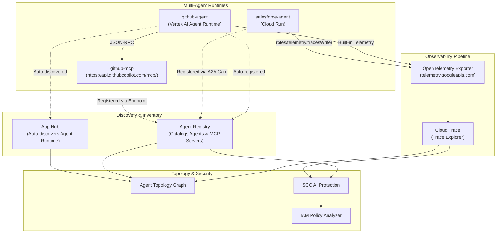

# Observe and Secure a Multi-Agent System — Step-by-Step Guide & Runbook

Comprehensive documentation, step-by-step walkthrough, and automation runbook for the **Observe and Secure a Multi-Agent System** Google Cloud lab.

---

## Architecture Overview

In a multi-agent system spanning multiple runtimes (**Vertex AI Agent Runtime** and **Cloud Run**) and external tools (**GitHub MCP Server**), observability and security rely on two foundational pillars:

1. **Distributed Tracing (OpenTelemetry → Cloud Trace)**:
   - Agents instrumented with `google-adk[otel-gcp]` (`opentelemetry-instrumentation-google-genai`) emit `agent_run`, `call_llm`, and `execute_tool` spans.
   - `setup_telemetry()` configures `get_gcp_exporters(enable_cloud_tracing=True)` targeting the Telemetry OTLP API (`telemetry.googleapis.com`).
   - Exporting requires `roles/telemetry.tracesWriter` on the runtime identity (managed automatically for Agent Runtime; granted explicitly to the Cloud Run service account).
2. **Resource Discovery & Registration (App Hub + Agent Registry)**:
   - **Agent Runtime** agents (`github-agent`) are automatically cataloged by App Hub (`functionalType: AGENT`) and registered in Agent Registry.
   - **Cloud Run** agents (`salesforce-agent`) are registered manually in Agent Registry using their A2A Agent Card (`/.well-known/agent-card.json`).
   - **MCP Servers** (`github-mcp`) are registered manually in Agent Registry with their endpoint URL and protocol (`JSONRPC`).

Once traces are flowing and assets are registered, **Agent Topology** builds the runtime interaction graph and **Security Command Center (SCC) AI Protection** + **IAM Policy Analyzer** surface and remediate identity risks (such as over-privileged service accounts).



---

## Repository Structure

| File | Description |
|------|-------------|
| [`README.md`](./README.md) | Complete step-by-step walkthrough for Tasks 1–10 with commands, outputs, and explanations |
| [`RUNBOOK.md`](./RUNBOOK.md) | Operational runbook, verification checklist, and troubleshooting guide |
| [`scripts/run_all_tasks.sh`](./scripts/run_all_tasks.sh) | Automated, idempotent bash script to execute Tasks 1–9 end-to-end |
| [`examples/pyproject.toml`](./examples/pyproject.toml) | Reference `pyproject.toml` showing `google-adk[gcp,otel-gcp]` and GenAI OpenTelemetry dependencies |
| [`examples/telemetry.py`](./examples/telemetry.py) | Reference `app/app_utils/telemetry.py` showing `setup_telemetry()` and `get_gcp_exporters(enable_cloud_tracing=True)` |
| [`examples/salesforce_card.sample.json`](./examples/salesforce_card.sample.json) | Sample A2A Agent Card (`/.well-known/agent-card.json`) for `salesforce-agent` |

---

## Step-by-Step Lab Walkthrough

### Task 1. Configure Environment & Enable Required APIs

Set up your environment variables, install/verify `google-agents-cli`, confirm the running agents, and enable the Observability, Discovery, and Security APIs.

```bash
export PROJECT_ID=$(gcloud config get-value project)
export LOCATION=us-central1
gcloud config set project ${PROJECT_ID}

export PROJECT_NUMBER=$(gcloud projects describe ${PROJECT_ID} --format='value(projectNumber)')
export ORGANIZATION_ID=$(gcloud projects get-ancestors ${PROJECT_ID} --format=json | jq -r '.[] | select(.type=="organization") | .id')
echo "Project: ${PROJECT_ID} (${PROJECT_NUMBER}), Org: ${ORGANIZATION_ID}, Location: ${LOCATION}"
```

Copy the lab assets (if not already present) and verify `agents-cli`:

```bash
gcloud storage cp -r gs://${PROJECT_ID}-bucket/agents ~/
export PATH="${HOME}/.local/bin:${PATH}"
agents-cli info
```

Verify the deployed Cloud Run service (`salesforce-agent`) and Agent Runtime Reasoning Engine (`github-agent`):

```bash
gcloud run services list --project=${PROJECT_ID} --region=${LOCATION} --format="table(metadata.name)"

curl -s -H "Authorization: Bearer $(gcloud auth print-access-token)" \
  "https://${LOCATION}-aiplatform.googleapis.com/v1/projects/${PROJECT_ID}/locations/${LOCATION}/reasoningEngines" \
  | jq -r '(.reasoningEngines // [])[] | "\(.displayName)\t\(.name)"'
```

Enable the required Google Cloud APIs:

```bash
gcloud services enable \
  observability.googleapis.com \
  cloudtrace.googleapis.com \
  telemetry.googleapis.com \
  apphub.googleapis.com \
  apptopology.googleapis.com \
  agentregistry.googleapis.com \
  cloudasset.googleapis.com \
  monitoring.googleapis.com \
  logging.googleapis.com \
  --project=${PROJECT_ID}
```

---

### Task 2. Export Traces to Cloud Trace

#### 1. Inspect the Instrumentation Code
Each agent requires three things to export traces to Cloud Trace:
1. **Instrumentation library** in [`examples/pyproject.toml`](./examples/pyproject.toml):
   ```toml
   dependencies = [
       "google-adk[gcp,otel-gcp]>=2.0.0,<3.0.0",
       "opentelemetry-instrumentation-google-genai>=0.1.0,<1.0.0",
       ...
   ]
   ```
2. **Exporter configuration** in [`examples/telemetry.py`](./examples/telemetry.py):
   ```python
   otel_hooks = get_gcp_exporters(
       enable_cloud_tracing=True,
       enable_cloud_metrics=False,
       enable_cloud_logging=True,
       google_auth=(credentials, project_id),
   )
   ```
3. **IAM Permission (`roles/telemetry.tracesWriter`)** on the agent's runtime service account.

#### 2. Grant the Trace-Writer Role to the Cloud Run Agent's Service Account
Agent Runtime agents (`github-agent`) export traces through managed built-in telemetry. Cloud Run agents (`salesforce-agent`) export as their own service account (the Compute Engine default service account in this lab) and require `roles/telemetry.tracesWriter`:

```bash
export SF_SA=$(gcloud run services describe salesforce-agent \
  --region=${LOCATION} \
  --project=${PROJECT_ID} \
  --format='value(spec.template.spec.serviceAccountName)')

echo "Salesforce Agent Service Account: ${SF_SA}"

gcloud projects add-iam-policy-binding ${PROJECT_ID} \
  --member="serviceAccount:${SF_SA}" \
  --role="roles/telemetry.tracesWriter" \
  --condition=None
```

#### 3. Generate Traffic to Emit Traces
Find the `github-agent` Reasoning Engine resource URL (without `:query` at the end) and send a query using `agents-cli run`:

```bash
export RE_NAME=$(curl -s -H "Authorization: Bearer $(gcloud auth print-access-token)" \
  "https://${LOCATION}-aiplatform.googleapis.com/v1/projects/${PROJECT_ID}/locations/${LOCATION}/reasoningEngines" \
  | jq -r '.reasoningEngines[] | select(.displayName=="github-agent") | .name')

export GITHUB_RE_URL="https://${LOCATION}-aiplatform.googleapis.com/v1/${RE_NAME}"
echo "Querying: ${GITHUB_RE_URL}"

agents-cli run \
  --url "${GITHUB_RE_URL}" \
  --mode adk \
  --app-name app \
  "Hello, what tools do you have?"
```

Also query `salesforce-agent` so that both agents emit traces:

```bash
export SF_URL=$(gcloud run services describe salesforce-agent \
  --region=${LOCATION} \
  --project=${PROJECT_ID} \
  --format='value(status.url)')

agents-cli run \
  --url "${SF_URL}" \
  --mode adk \
  --app-name app \
  "Search Salesforce documents for onboarding"
```

#### 4. Confirm Traces in Cloud Trace Explorer
1. Open the Google Cloud Console → **Monitoring** → **Trace explorer**.
2. Set the time range to **Last 1 hour**.
3. Filter by span name `call_llm` or `agent_run` to inspect the waterfall view (`agent_run`, `call_llm`, and `execute_tool` spans).

> **Checkpoint**: Click **Check my progress** for *"Grant the trace-writer role to an agent's service account"*.

---

### Task 3. Confirm Agent Runtime Agents Are Already Discovered

1. List the agents automatically registered in **Agent Registry** and confirm `github-agent` is present:
   ```bash
   gcloud alpha agent-registry agents list \
     --location=${LOCATION} \
     --project=${PROJECT_ID} \
     --format="table(displayName)"
   ```
   **Expected Output:**
   ```text
   DISPLAY_NAME
   Workspace Agent
   github-agent
   ```

2. Confirm **App Hub** classifies the Reasoning Engine workload as `AGENT`:
   ```bash
   export TOKEN=$(gcloud auth print-access-token)
   curl -s -H "Authorization: Bearer ${TOKEN}" \
     -H "x-goog-user-project: ${PROJECT_ID}" \
     "https://apphub.googleapis.com/v1/projects/${PROJECT_ID}/locations/${LOCATION}/discoveredWorkloads" \
     | jq -r '.discoveredWorkloads[] | "\(.workloadProperties.functionalType.type // "-")\t\(.workloadReference.uri)"'
   ```
   **Expected Output:**
   ```text
   AGENT   //aiplatform.googleapis.com/projects/<PROJECT_NUMBER>/locations/us-central1/reasoningEngines/<RE_ID>
   ```

---

### Task 4. Register the Cloud Run Agent (`salesforce-agent`)

Cloud Run services are not automatically labeled as agents. You must grant the Discovery Engine service agent invoker permissions, download the A2A agent card, and register `salesforce-agent` in Agent Registry.

#### 1. Create the Discovery Engine Service Identity & Grant `roles/run.invoker`

```bash
gcloud beta services identity create \
  --service=discoveryengine.googleapis.com \
  --project=${PROJECT_ID}

gcloud run services add-iam-policy-binding salesforce-agent \
  --region=${LOCATION} \
  --project=${PROJECT_ID} \
  --member="serviceAccount:service-${PROJECT_NUMBER}@gcp-sa-discoveryengine.iam.gserviceaccount.com" \
  --role="roles/run.invoker"
```

> **Checkpoint**: Click **Check my progress** for *"Grant the Discovery Engine service agent invoker access"*.

#### 2. Fetch the A2A Agent Card and Register `salesforce-agent`

```bash
export SF_URL=$(gcloud run services describe salesforce-agent \
  --region=${LOCATION} \
  --project=${PROJECT_ID} \
  --format='value(status.url)')
export TOKEN=$(gcloud auth print-identity-token)

curl -s -H "Authorization: Bearer ${TOKEN}" \
  "${SF_URL}/a2a/app/.well-known/agent-card.json" \
  -o salesforce_card.json

gcloud alpha agent-registry services create salesforce-agent \
  --location=${LOCATION} \
  --project=${PROJECT_ID} \
  --agent-spec-type=a2a-agent-card \
  --agent-spec-content=salesforce_card.json
```

Verify that `salesforce_agent` now appears in Agent Registry:

```bash
gcloud alpha agent-registry agents list \
  --location=${LOCATION} \
  --project=${PROJECT_ID} \
  --format="table(displayName,location)"
```

> **Checkpoint**: Click **Check my progress** for *"Register the Cloud Run agent in Agent Registry"*.

---

### Task 5. Register the GitHub MCP Server (`github-mcp`)

Register the external GitHub MCP server used by `github-agent` so it appears as an MCP node in Agent Topology and SCC AI Protection:

```bash
gcloud alpha agent-registry services create github-mcp \
  --location=${LOCATION} \
  --project=${PROJECT_ID} \
  --mcp-server-spec-type=no-spec \
  --interfaces="url=https://api.githubcopilot.com/mcp/,protocolBinding=JSONRPC"
```

Confirm the MCP server is registered:

```bash
gcloud alpha agent-registry mcp-servers list \
  --location=${LOCATION} \
  --project=${PROJECT_ID}
```

> **Checkpoint**: Click **Check my progress** for *"Register the GitHub MCP server in Agent Registry"*.

---

### Task 6. View the Agent Topology Graph

1. In the Google Cloud Console, navigate to **Agent Platform** → **Agent Registry**.
2. Select your lab project.
3. On the **Agents** tab, click `github-agent` (or `salesforce_agent`).
4. Select the **Topology** tab to view the multi-runtime system graph connecting `github-agent`, `salesforce_agent`, and `github-mcp`.

*(Note: Agent Topology aggregates trace spans in batches, so edges may take some time to populate in Preview.)*

---

### Task 7. See the Fleet in SCC AI Protection & Simulate Over-Privilege

1. Navigate to **Agent Platform** → **Agents** → **Security** tab (`https://console.cloud.google.com/agent-platform/security`).
2. Review the AI inventory and risk widgets.
3. If `roles/editor` is not already bound to `salesforce-agent`'s service account (`${SF_SA}`), simulate an over-privileged grant:

```bash
export SF_SA=$(gcloud run services describe salesforce-agent \
  --region=${LOCATION} \
  --project=${PROJECT_ID} \
  --format='value(spec.template.spec.serviceAccountName)')

gcloud projects add-iam-policy-binding ${PROJECT_ID} \
  --member="serviceAccount:${SF_SA}" \
  --role="roles/editor" \
  --condition=None
```

---

### Task 8. Identify the Security Finding & Scope Using Policy Analyzer

1. In the **Agent Platform Security** tab, review the **Agents with excessive permissions** and **AI risks by severity** widgets to locate `salesforce_agent`.
2. Open **IAM & Admin** → **Policy Analyzer** in the Google Cloud Console.
3. Click **Create custom query**:
   - **Scope**: Current project (`${PROJECT_ID}`)
   - **Parameter 1**: **Principal** → `serviceAccount:${SF_SA}`
   - **Advanced options**: Check **List resources within resource(s) matching your query**
4. Click **Analyze** → **Run query** to verify that `roles/editor` grants broad access across almost every resource in the project.

---

### Task 9. Remediate & Verify Least Privilege

#### 1. Inspect Current Roles on the Service Account

```bash
gcloud projects get-iam-policy ${PROJECT_ID} \
  --flatten="bindings[].members" \
  --filter="bindings.members:${SF_SA}" \
  --format="value(bindings.role)"
```

Ensure all four narrow least-privilege roles are present:
- `roles/aiplatform.user`
- `roles/telemetry.tracesWriter`
- `roles/logging.logWriter`
- `roles/cloudtrace.agent`

#### 2. Remove the Over-Broad `roles/editor` Role

```bash
gcloud projects remove-iam-policy-binding ${PROJECT_ID} \
  --member="serviceAccount:${SF_SA}" \
  --role="roles/editor"
```

#### 3. Confirm `roles/editor` Is Removed

```bash
gcloud projects get-iam-policy ${PROJECT_ID} \
  --flatten="bindings[].members" \
  --filter="bindings.members:${SF_SA} AND bindings.role:roles/editor" \
  --format="value(bindings.role)"
```

This command returns empty output, and listing all roles for `${SF_SA}` confirms only the four narrow roles remain:

```text
roles/aiplatform.user
roles/cloudtrace.agent
roles/logging.logWriter
roles/telemetry.tracesWriter
```

> **Checkpoint**: Click **Check my progress** for *"Remediate the over-privileged agent"*.

---

### Task 10. (Optional) Trigger & View an Agent's Runtime Attacks

1. In the **Agent Platform Security** tab, inspect the **AI threats** widget.
2. You can test **Agent Platform Threat Detection** by deploying the documented test agent that executes a harmless simulated attack (such as the standard EICAR test binary).
3. Review resulting findings (e.g., `Execution: Added Malicious Binary Executed`) in **Security Command Center** → **Findings**.
